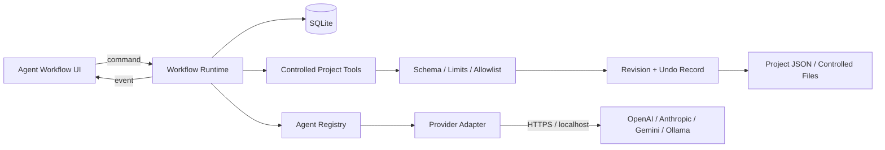
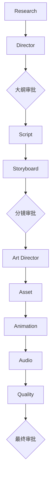

# Agent 与 Workflow 实现

## 1. 运行边界

Agent 系统运行在 Tauri 的 Rust 后端。React 只负责启动、暂停、审批和展示持久状态，不直接调用模型、读取密钥或写入项目文件。



模型只能输出工具请求。运行时检查 Agent 是否被允许调用该工具，再将输入规范化为项目数据。Agent 永远不能提交文件路径或执行任意代码。

## 2. 统一 Agent 接口

每个 Agent 实现同一接口：

```rust
#[async_trait]
pub trait Agent: Send + Sync {
    fn descriptor(&self) -> AgentDescriptor;
    async fn execute(
        &self,
        input: AgentInput,
        provider: &dyn LlmProvider,
        model: &str,
    ) -> Result<AgentOutput, String>;
}
```

`AgentInput`：

```json
{
  "project": {},
  "instruction": "用户自然语言修改要求",
  "dependencyOutputs": {},
  "targetSceneIds": [],
  "agentKey": "director"
}
```

`AgentOutput`：

```json
{
  "summary": "本次执行摘要",
  "changes": [
    {
      "tool": "replaceOutline",
      "input": {}
    }
  ],
  "warnings": [],
  "needsAttention": false
}
```

接口详情由 `agent_workflow_definition` 命令返回，包含每个 Agent 的依赖、审批要求、输入 Schema、输出 Schema 和工具白名单。

## 3. Agent DAG



| Agent | 职责 | 主要受控工具 |
|---|---|---|
| Research | 来源候选、事实风险与核验状态 | `setResearchSources` |
| Director | 钩子、知识顺序、叙事与目标时长 | `replaceOutline` |
| Script | 旁白、视觉建议与可朗读场景 | `replaceScenes` |
| Storyboard | 镜头、转场、构图和素材需求 | `replaceScenes` |
| Art Director | 统一视觉语言与场景提示词 | `replaceScenes`, `updateSettings` |
| Asset | 判断素材形式并生成本地 SVG 草案 | `generateSceneAssets`, `replaceAssets` |
| Animation | 结构化图层、时间点和运动参数 | `replaceScenes` |
| Audio | 字幕、旁白和轨道时间线 | `replaceSubtitles`, `replaceTimeline`, `updateAudio` |
| Quality | 事实、时长、素材、字幕与信息密度检查 | `setQualityReport` |

## 4. Provider 与 Agent 模型路由

Provider 协议支持：

- OpenAI Compatible
- Anthropic
- Gemini
- Ollama

每个 Agent 可以独立指定 `providerId` 和 `model`。运行开始时模型路由会写入 `workflow_runs.agent_routes_json`，恢复运行时使用同一配置。

API Key 通过 keyring 4.x 写入系统凭据库。SQLite 和项目文件只保存 Provider 元数据。Provider 连接测试和 Agent 模型调用都在 Rust 中完成。

## 5. 受控项目工具

工具调用先反序列化为强类型枚举，再进行以下检查：

- Agent 工具白名单。
- 单次变更数量和项目大小限制。
- 场景、字幕、片段、来源和图层数量限制。
- 数字范围、颜色格式、轨道类型和画幅枚举。
- 场景与素材关联、字幕时间顺序和项目必要字段。
- 项目 ID 和修订路径安全。

当前工具：

```text
setResearchSources
replaceOutline
replaceScenes
replaceAssets
generateSceneAssets
replaceTimeline
replaceSubtitles
updateSettings
updateAudio
setQualityReport
setStage
```

`generateSceneAssets` 由运行时创建本地 SVG Data URL，并自动关联场景。模型不提供文件路径。

## 6. 持久状态

| 表 | 用途 |
|---|---|
| `workflow_runs` | 运行状态、当前步骤、项目快照、Provider 和 Agent 路由 |
| `workflow_steps` | DAG 步骤、依赖、尝试次数、输出、审批、前后快照和错误 |
| `project_revisions` | 每次成功工具调用的前后项目快照与撤销状态 |
| `workflow_events` | 创建、执行、审批、失败、重试等审计事件 |
| `provider_calls` | Provider、模型、耗时、状态和脱敏错误 |

应用重启时：

- `running` 步骤恢复为 `pending`。
- `running/pending` 运行标记为 `paused`，错误码为 `APP_RESTARTED`。
- 用户可以从暂停状态恢复，或从失败步骤局部重跑。

## 7. Tauri IPC

```text
agent_workflow_definition()
workflow_start(request)
workflow_get(runId)
workflow_list(projectId, limit)
workflow_pause(runId)
workflow_resume(runId)
workflow_retry(runId)
workflow_rerun_step(runId, stepKey)
workflow_approve(runId, stepKey, decision, note)
workflow_undo_revision(runId, revisionId)
provider_save_secret(providerId, apiKey)
provider_clear_secret(providerId)
provider_test(request)
```

长时间执行不阻塞 WebView。Rust 后台任务更新 SQLite 后发出 `agent-workflow-changed` 事件，前端据此重新读取运行详情。

## 8. 自然语言修改

UI 允许选择目标 Agent 并输入修改要求。后端创建只包含该 Agent 的增量运行，把完整当前项目、用户指令以及受控工具列表作为上下文。生成结果仍会：

1. 通过相同 Schema 和工具白名单。
2. 写入项目修订。
3. 在审批节点暂停。
4. 支持撤销。

## 9. 本地重跑与撤销

局部重跑会：

1. 恢复目标步骤执行前的项目快照。
2. 把目标步骤和所有下游步骤重置为 `pending`。
3. 保留原修订历史用于审计和撤销。
4. 从目标 Agent 重新构建下游结果。

撤销修订会恢复该次工具调用前的项目快照，并同步写回项目目录；历史修订仍保留，但该修订标记为不可再次撤销。
