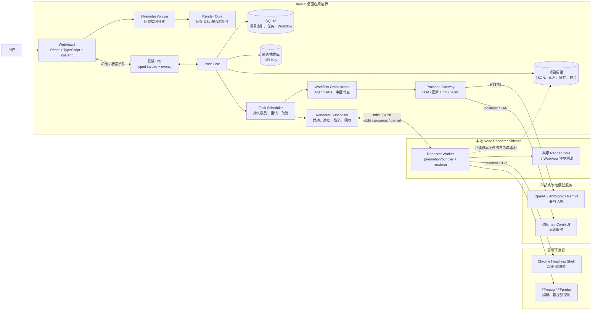
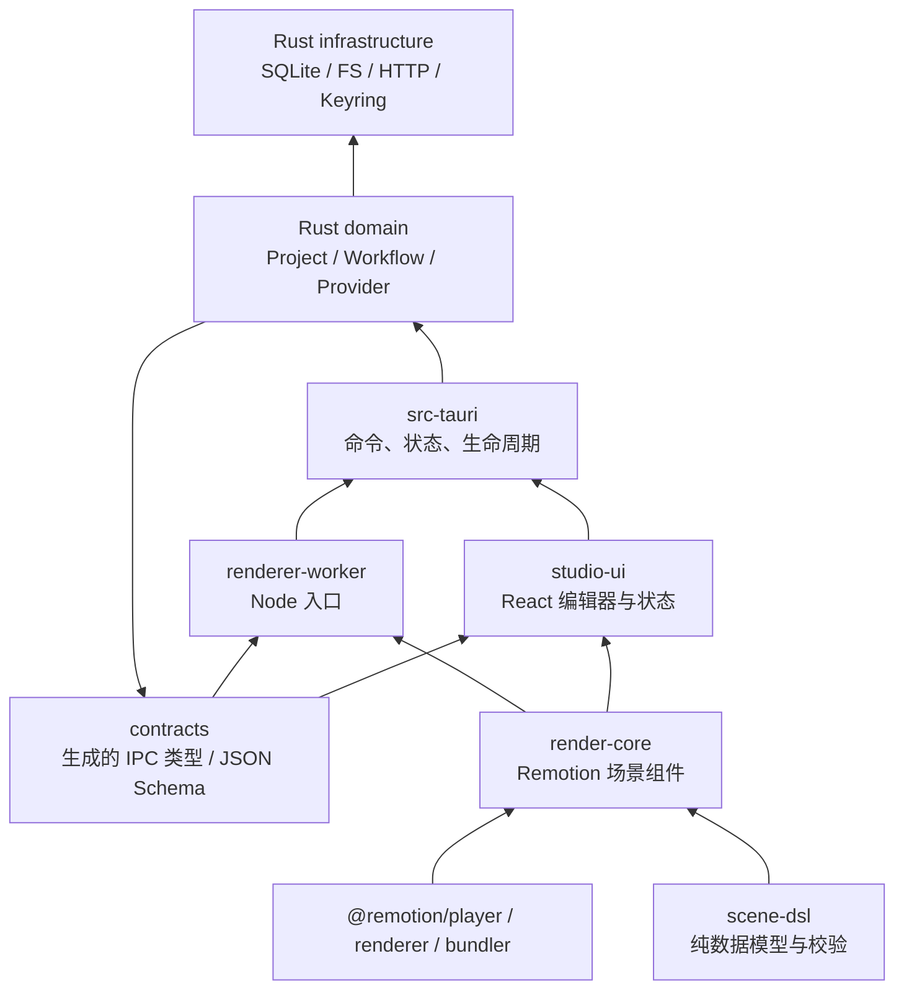
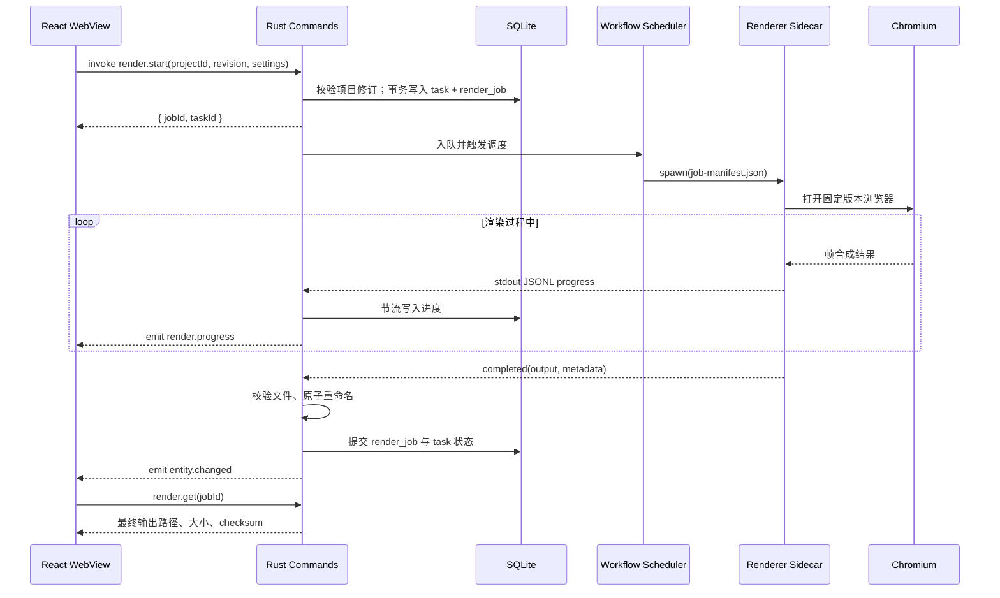
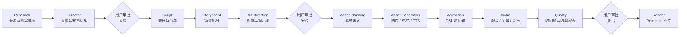
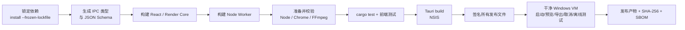

# KnowMotion AI Studio 技术架构

> 状态：架构基线 v1.0  
> 范围：Tauri 2 + React 桌面应用、AI Provider、Agent/Workflow、Remotion 渲染、本地存储、Windows 分发  
> 非目标：本阶段不实现业务功能、不创建页面、不编写 Agent 或 Remotion 业务代码。

## 1. 结论摘要

KnowMotion AI Studio 采用“一个桌面应用进程组 + 三个职责边界”的结构：

1. **Tauri WebView2 + React**：界面、编辑交互、Remotion Player 实时预览。
2. **Rust Core**：SQLite、项目文件、密钥、AI Provider 调用、Workflow 调度、任务状态、渲染进程监管。
3. **Node Renderer Sidecar + Chromium**：使用 Remotion 服务端 API 完成离线、可取消的正式视频渲染。

这不是微服务架构。Node sidecar 仅因为 Remotion 的服务端渲染能力依赖 Node.js 而存在，通过本地进程间通信受 Rust 管理，不对外开放网络端口。

关键决策：

- 不为用户安装系统 Node.js，也不依赖用户机器上的 Chrome。
- 随应用打包固定版本的 Node.js、Chrome Headless Shell 和 FFmpeg，并锁定三者与 Remotion 的兼容版本。
- Remotion Player 负责 WebView 内预览；`@remotion/renderer` 负责正式导出。二者共享同一套场景 DSL 和 React 渲染组件，降低预览与成片差异。
- AI 只产出经过 Schema 校验的结构化场景 DSL，不直接执行模型生成的任意 React/JavaScript 代码。
- 项目内容以项目目录中的版本化 JSON 为可移植的事实来源；SQLite 保存项目索引、运行状态、任务、用量和渲染记录。
- 所有耗时操作都先持久化为任务，再异步执行；UI 通过 command + event 查询进度，不等待长请求。

## 2. 系统架构图



### 2.1 运行位置划分

| 能力 | 运行位置 | 说明 |
|---|---|---|
| 页面、编辑器、列表、属性面板 | WebView2 / React | 不直接访问文件系统、系统凭据或外部 AI API |
| Remotion Player 预览 | WebView2 | 浏览器内实时播放，不启动 Node 或 Chromium |
| 项目 CRUD 与自动保存 | Rust | 校验、加锁、原子写入；SQLite 记录索引与修订 |
| API Key 存取 | Rust | 仅从系统凭据库读取，不向 WebView 返回明文 |
| LLM、图片、TTS、ASR 请求 | Rust | 统一 Provider Adapter；网络错误、重试、用量在 Rust 记录 |
| Agent 决策与 Workflow 状态机 | Rust | 输入输出结构化；持久化、可暂停、可恢复 |
| 图片下载、音频落盘、媒体探测 | Rust + FFprobe | 临时文件校验后原子提交到项目素材目录 |
| 完整 MP4 渲染 | Node / Remotion Renderer | 以不可变 Job Manifest 作为输入，输出 `.partial.mp4` |
| Chromium 帧合成 | Chrome Headless Shell | 由 Remotion 通过 CDP 控制，不暴露固定调试端口 |
| 最终音视频编码 | Remotion + FFmpeg | `renderMedia()` 负责合成和编码，必要时再执行后处理 |
| 项目素材访问 | 自定义受限协议 + Rust | WebView 中只暴露已登记资产；渲染器使用白名单绝对路径 |

## 3. 模块依赖图



依赖规则：

- `domain` 不依赖 Tauri、SQLite、HTTP 客户端或具体 Provider。
- UI 不导入 Rust 内部模块，只使用生成后的 IPC 类型。
- `render-core` 不依赖编辑器状态、Zustand、Tauri API 或项目文件系统。
- `renderer-worker` 只消费 Job Manifest 和 `render-core`，不连接 SQLite、不读取密钥。
- 外部 Provider SDK 只能存在于 Rust infrastructure adapter 中。
- 所有跨进程消息都携带 `schemaVersion`；不兼容升级需要显式迁移。

## 4. 技术选型

| 领域 | 选型 | 原因 |
|---|---|---|
| 桌面外壳 | Tauri 2 | 包体比 Electron 更小；Rust 后端适合文件、进程和任务管理；Windows 使用系统 WebView2 |
| 前端 | React 19 + TypeScript + Vite | 与 Remotion 技术栈一致；Vite 开发快；类型生态成熟 |
| 前端状态 | Zustand | 适合编辑器局部状态；避免把服务端持久状态复制成全局数据仓库 |
| 类型契约 | Rust `serde` + `specta`/`tauri-specta` 生成 TS | 减少手写 IPC 类型漂移；边界模型可版本化 |
| Schema | `schemars` + JSON Schema Draft 2020-12 | 模型输出、项目文件、导入导出使用同一份约束 |
| 数据库 | SQLite + `rusqlite` | 单用户桌面场景足够；事务、WAL、全文检索和迁移简单可靠 |
| AI 调用 | Rust `reqwest` + 能力型 Adapter | 密钥和网络请求不进入 WebView；便于统一超时、重试、用量和错误分类 |
| 密钥 | 系统凭据库：Credential Manager / Keychain / Secret Service | 不用自实现加密；密钥不进入 SQLite、项目 JSON 或日志 |
| 动画预览 | `@remotion/player` | 在 WebView 中提供接近成片的实时预览 |
| 正式渲染 | 固定版本 Node + `@remotion/bundler` + `@remotion/renderer` | Remotion 的原生服务端渲染路径；可控制浏览器、FFmpeg、并发和取消 |
| 浏览器 | 随应用打包的 Chrome Headless Shell | 不依赖系统 Chrome；生产导出离线可重复；不能依赖 WebView2 代替 |
| 音视频 | Remotion 使用的 FFmpeg/FFprobe；后续可加独立后处理二进制 | 减少版本冲突；同时保留格式转换和音频探测能力 |
| 进程通信 | Tauri command/events + sidecar stdout JSONL | 本地、无端口、无 CORS；易于 Rust 监管子进程生命周期 |
| 日志 | 有界队列 + 本地轮转 JSONL writer | 包含 jobId 和结构化字段；统一脱敏 API Key、Authorization、提示词与其他敏感值 |
| 测试 | Rust unit/integration + Vitest + 干净 Windows VM smoke test | 覆盖状态机、存储、IPC、渲染和打包，不只测试 UI |

## 5. 推荐仓库结构

```text
KnowMotion-AI-Studio/
├─ apps/
│  ├─ studio/
│  │  ├─ src/
│  │  │  ├─ app/                 # 路由、Shell、错误边界
│  │  │  ├─ features/            # dashboard、project、storyboard、editor
│  │  │  ├─ ipc/                 # 生成绑定的薄封装
│  │  │  ├─ stores/              # UI 临时状态、选择状态
│  │  │  └─ styles/
│  │  └─ package.json
│  └─ renderer-worker/
│     ├─ src/
│     │  ├─ main.ts              # Job Manifest 入口
│     │  ├─ bundle.ts            # Remotion bundle
│     │  ├─ render.ts            # renderMedia / renderStill
│     │  └─ protocol.ts          # stdout JSONL 事件
│     └─ package.json
├─ packages/
│  ├─ contracts/                 # 跨进程 DTO、枚举、版本号
│  ├─ scene-dsl/                 # 纯数据 Schema、迁移、校验
│  └─ render-core/
│     ├─ src/
│     │  ├─ compositions/
│     │  ├─ scenes/
│     │  ├─ motion/
│     │  └─ registry.ts
│     └─ package.json
├─ src-tauri/
│  ├─ src/
│  │  ├─ commands/               # 薄命令层，只做鉴权与参数适配
│  │  ├─ application/            # use cases
│  │  ├─ domain/                 # project、workflow、provider、asset
│  │  ├─ infrastructure/         # SQLite、FS、HTTP、keyring、process
│  │  ├─ jobs/                   # scheduler、worker、recovery
│  │  └─ lib.rs
│  ├─ capabilities/
│  ├─ binaries/                  # Node sidecar，构建时注入
│  ├─ resources/                 # Chromium、FFmpeg、renderer bundle
│  ├─ migrations/
│  ├─ Cargo.toml
│  └─ tauri.conf.json
├─ schemas/
│  ├─ project.schema.json
│  ├─ outline.schema.json
│  ├─ storyboard.schema.json
│  ├─ scene.schema.json
│  ├─ workflow.schema.json
│  └─ render-job.schema.json
├─ scripts/
│  ├─ generate-contracts
│  ├─ stage-renderer-runtime
│  └─ verify-release-assets
├─ tests/
│  ├─ fixtures/
│  ├─ render-smoke/
│  └─ windows-vm/
├─ docs/
└─ package.json
```

## 6. 前端与 Rust 通信设计

### 6.1 原则

- 只有明确命名的命令，不提供通用 `execute(command)` 或任意文件读写接口。
- command 只处理快速操作并返回 DTO；任何预期超过 1 秒的操作返回 `jobId`。
- Tauri event 只发送小型状态信封；对象详情按 ID 再查询，避免大对象穿过 IPC。
- 所有写操作携带 `requestId` 和可选的 `expectedRevision`，用于幂等与并发冲突检测。
- Rust 是持久状态的唯一写入者。WebView 不直接改 SQLite 或 JSON 文件。
- 错误返回稳定错误码，不把后端堆栈、API Key、完整响应体传入 UI。

### 6.2 核心 IPC 接口

以下为语言无关契约；实际 TypeScript 类型由 Rust 模型生成。

```ts
type CommandMap = {
  "project.list": {
    input: { cursor?: string; limit: number };
    output: { items: ProjectSummary[]; nextCursor?: string };
  };
  "project.create": {
    input: CreateProjectInput;
    output: { project: ProjectManifest };
  };
  "project.open": {
    input: { projectId: string };
    output: { project: ProjectManifest; files: ProjectFileSummary[] };
  };
  "project.saveDocument": {
    input: {
      projectId: string;
      documentKind: "outline" | "narration" | "storyboard" | "timeline";
      expectedRevision: number;
      document: unknown;
    };
    output: { revision: number; updatedAt: string };
  };
  "provider.upsert": {
    input: ProviderDraft;
    output: { provider: ProviderProfile };
  };
  "provider.test": {
    input: { providerId: string };
    output: { jobId: string };
  };
  "workflow.start": {
    input: { projectId: string; workflowKey: string; inputRevision: number };
    output: { runId: string };
  };
  "workflow.approveStep": {
    input: {
      runId: string;
      stepId: string;
      decision: "approve" | "request_changes";
      note?: string;
    };
    output: { stepStatus: WorkflowStepStatus };
  };
  "task.list": {
    input: { projectId?: string; statuses?: TaskStatus[]; limit: number };
    output: { items: TaskSummary[] };
  };
  "task.cancel": {
    input: { taskId: string };
    output: { status: TaskStatus };
  };
  "render.start": {
    input: RenderRequest;
    output: { jobId: string; taskId: string };
  };
  "render.cancel": {
    input: { jobId: string };
    output: { status: RenderJobStatus };
  };
};

type EventMap = {
  "entity.changed": {
    eventId: string;
    entity: "project" | "task" | "workflow" | "render";
    entityId: string;
    change: "created" | "updated" | "deleted";
    at: string;
  };
  "task.progress": {
    eventId: string;
    taskId: string;
    status: TaskStatus;
    progress: { value: number; stage?: string; message?: string };
    at: string;
  };
  "render.progress": {
    eventId: string;
    jobId: string;
    percent: number;
    renderedFrames: number;
    encodedFrames: number;
    stage: RenderStage;
    at: string;
  };
};
```

### 6.3 交互流程



进度写入应节流，例如每 250–500 ms 或进度变化至少 1% 时写入一次，避免 SQLite 和 UI event 过载。

### 6.4 Tauri 权限边界

- WebView 不获得通用 shell、文件系统或 HTTP 插件权限。
- 不向 WebView 暴露 sidecar 启动能力；由 `render.start` 命令在 Rust 内部启动和监管进程。
- 自定义命令按窗口注册；开发工具窗口与主窗口的权限分开。
- Tauri capabilities 采用最小集合，禁止远程 URL 获得本地 IPC。
- 生产 CSP 禁止任意远程脚本和 `eval`；模型返回内容必须作为数据渲染。
- 外部链接交给系统浏览器，不在应用 WebView 中加载任意第三方页面。

## 7. Remotion 集成方案

### 7.1 预览和成片是两个运行路径

| 路径 | 技术 | 用途 | 约束 |
|---|---|---|---|
| 实时预览 | `@remotion/player` | 编辑时播放、拖动时间轴、单场景预览 | 完全运行在 WebView；只读当前场景数据 |
| 正式导出 | Node `@remotion/bundler` + `@remotion/renderer` | MP4、封面帧、批量导出 | 必须由 Rust 启动受管 sidecar |

两条路径都使用 `packages/render-core` 和 `packages/scene-dsl`。预览不能把编辑状态直接传给其专属组件，成片也不能有另一套视觉实现。

### 7.2 为什么不能只用 WebView2 渲染

- WebView2 是系统组件，生命周期和可执行路径由 Windows 管理，不适合作为 Remotion 的可重复、固定版本渲染浏览器。
- Remotion 服务端渲染依赖 Chrome/Chromium 的 CDP、headless 模式、帧控制和 FFmpeg 流程。
- WebView2 适合应用界面，不应该承担最终编码工作，也无法提供可靠的离线、版本锁定渲染环境。
- 正式导出需在 UI 关闭、切换项目或取消任务时仍能被 Rust 精确管理和终止。

### 7.3 为什么不依赖系统 Node.js

系统 Node 版本、全局依赖和 PATH 不受应用控制，会导致以下不可接受的问题：

- 用户未安装 Node.js 或版本不兼容。
- Remotion、Puppeteer、Sharp、FFmpeg 相关依赖版本漂移。
- 首次渲染自动下载浏览器或 FFmpeg，导致离线失败和安全风险。
- 不同机器产生不同输出，难以复现渲染问题。

因此采用固定版本 Node LTS sidecar。Tauri 的 `externalBin` 支持带目标三元组的平台二进制；Windows 构建产物使用 `x86_64-pc-windows-msvc` 命名，并与其他平台二进制分开构建。WebView 不直接调用它。

### 7.4 打包后的渲染运行模型

```text
Tauri 安装目录/
├─ KnowMotion AI Studio.exe
├─ node.exe
├─ resources/
│  ├─ renderer/
│  │  ├─ worker.cjs
│  │  ├─ renderer-entry.js
│  │  └─ node_modules/          # 或经验证的单文件 bundle
│  ├─ browser/
│  │  └─ chrome-headless-shell.exe
│  ├─ ffmpeg/
│  │  ├─ ffmpeg.exe
│  │  └─ ffprobe.exe
│  └─ licenses/
└─ ...
```

构建时由脚本解析并写入 `runtime-manifest.json`：

```json
{
  "rendererVersion": "pinned",
  "nodeVersion": "pinned",
  "chromeVersion": "pinned",
  "ffmpegVersion": "pinned",
  "browserExecutable": "resources/browser/chrome-headless-shell.exe",
  "ffmpegExecutable": "resources/ffmpeg/ffmpeg.exe",
  "files": [
    { "path": "resources/renderer/worker.cjs", "sha256": "..." }
  ]
}
```

安装后、升级前和启动渲染服务前都校验哈希。应用不能动态更新其中一个组件而不同步更新其他组件。

### 7.5 渲染任务实现方式

MVP 推荐“一次渲染任务启动一个 Node worker 进程”，而不是维护一个长期 HTTP 服务：

1. Rust 生成不可变 Job Manifest，写入项目 `cache/render-jobs/{jobId}.json`。
2. Rust 启动 Node sidecar，参数是一个文件路径，而不是超长命令行 JSON。
3. Node worker 读取 Manifest，校验 `rendererVersion/inputRevision`。
4. Worker 调用 `bundle()` 加载固定入口，调用 `selectComposition()` 取得 composition。
5. Worker 调用 `renderMedia()`，传入：
   - `inputProps`
   - 固定 `browserExecutable`
   - 固定 `ffmpegExecutable`
   - `outputLocation = renders/{name}.partial.mp4`
   - `codec = "h264"`（默认），音频编码按容器约束选择
   - `onProgress`
   - `cancelSignal`
6. 进度和错误以 JSON Lines 写入 stdout；日志只写 stderr。
7. 成功后在同卷原子重命名为最终文件名，再由 Rust 计算 SHA-256 并写入数据库。

这种方式比本地 HTTP 服务简单：没有端口分配、防火墙提示、CORS、鉴权和常驻服务生命周期问题。缺点是每次渲染有进程启动开销，但相对视频编码时间可以接受；后续只有在基准测试证明值得时，才演进为复用 warm worker。

### 7.6 浏览器与 FFmpeg 管理

Remotion 的 `ensureBrowser()` 支持传入已有浏览器可执行文件路径，并支持 `chromeMode: "headless-shell"` 与 `chrome-for-testing`；`renderMedia()` 也支持显式 `browserExecutable` 和 `ffmpegExecutable`。生产应用采用：

- 构建阶段预先准备 `chrome-headless-shell`，不调用在线下载。
- `ensureBrowser({ browserExecutable: bundledPath, chromeMode: "headless-shell" })` 作为启动前自检。
- `renderMedia()` 显式传入相同浏览器路径和打包 FFmpeg 路径。
- 启动任务前验证文件存在、哈希匹配、可执行版本匹配。
- 任何缺失都转为明确的 `RENDER_RUNTIME_MISSING` 错误，并提供“修复安装”入口；禁止静默联网下载。

### 7.7 进程监管、取消和退出

- Rust 只允许同时运行一个正式 MP4 渲染任务，避免 4K 渲染争用内存和 GPU。
- Node worker 为每个 job 持有取消令牌；stdin 收到 `cancel` 后通过 Remotion 支持的 `cancelSignal` 中断。
- 取消后先等待受控退出；超时后杀掉进程树。
- Windows 创建 Job Object 并设置 `JOB_OBJECT_LIMIT_KILL_ON_JOB_CLOSE`，确保 Tauri 崩溃或退出时 Chromium/Node 子进程不会残留。
- 启动进程时使用绝对路径和参数数组，不拼接 shell 字符串，避免空格、中文路径和命令注入问题。
- 每个 job 使用独立临时目录；启动和恢复时清理超过保留期的 `.partial` 文件。
- 应用重启时，数据库中标记为 `running` 的渲染任务转为 `interrupted`，默认让用户重试，不假装任务仍在运行。

当前实现已为每个正式渲染 Job 创建独立 Windows Job Object，并设置 `JOB_OBJECT_LIMIT_KILL_ON_JOB_CLOSE` 与最多 64 个进程的 `JOB_OBJECT_LIMIT_ACTIVE_PROCESS`。Node Worker 在启动后立即加入 Job，后续 Chromium、FFmpeg 等子进程自动继承作业树。取消时先等待 4 秒协作式退出，随后调用 `TerminateJobObject`；Tauri 崩溃或正常退出时，内核关闭最后一个 Job 句柄并回收整棵树。

### 7.8 场景 DSL，而不是任意生成代码

`scene-dsl` 是固定 Schema 的判别联合，例如 `text`、`image`、`shape`、`chart`、`video`、`group`、`particle`。动画参数通过 keyframe/easing 数据表达，而不是执行 AI 返回的 JavaScript。

原因：

- 可校验、可迁移、可撤销、可局部重新生成。
- WebView 预览与 Node 渲染能使用同一解释器。
- 避免任意代码执行、供应链和可维护性问题。
- 用户仍可通过预设组件库获得丰富的粒子、转场、图表和镜头运动能力。

未来若支持自定义代码场景，必须作为显式、受信任的插件能力单独设计，不纳入普通项目 JSON。

## 8. AI Provider 抽象层

### 8.1 能力拆分

业务层只请求能力，不指定供应商：

```ts
type ProviderCapability = "llm" | "image" | "tts" | "asr" | "embedding";

interface ProviderProfile {
  id: string;
  name: string;
  protocol:
    | "openai_compatible"
    | "anthropic"
    | "gemini"
    | "ollama"
    | "comfyui"
    | "custom";
  baseUrl: string;
  credentialRef?: string;          // 系统凭据库中的引用，不是密钥本身
  capabilities: CapabilityBinding[];
  health: "unknown" | "healthy" | "unhealthy";
  enabled: boolean;
}

interface CapabilityBinding {
  capability: ProviderCapability;
  model: string;
  defaults: Record<string, unknown>;
}
```

核心接口：

```ts
interface LlmProvider {
  complete(request: LlmRequest, ctx: CallContext): Promise<LlmResult>;
  stream?(request: LlmRequest, ctx: CallContext): AsyncIterable<LlmDelta>;
}

interface ImageProvider {
  generate(request: ImageRequest, ctx: CallContext): Promise<ProviderArtifact[]>;
}

interface TtsProvider {
  synthesize(request: TtsRequest, ctx: CallContext): Promise<ProviderArtifact>;
}

interface AsrProvider {
  transcribe(request: AsrRequest, ctx: CallContext): Promise<Transcript>;
}

interface EmbeddingProvider {
  embed(request: EmbeddingRequest, ctx: CallContext): Promise<EmbeddingResult>;
}
```

所有接口共享：

```ts
interface CallContext {
  taskId: string;
  projectId?: string;
  timeoutMs: number;
  cancelToken: string;
  idempotencyKey: string;
}

type ProviderErrorCode =
  | "AUTH"
  | "RATE_LIMIT"
  | "TIMEOUT"
  | "NETWORK"
  | "CONTENT_FILTER"
  | "INVALID_RESPONSE"
  | "UNSUPPORTED_CAPABILITY"
  | "UPSTREAM_ERROR";
```

### 8.2 Provider 适配器

建议的首批适配器：

- `OpenAiCompatibleLlm`：OpenAI 与兼容服务。
- `AnthropicLlm`。
- `GeminiLlm`。
- `OllamaLlm`。
- `GgufLocalLlm`：进程内加载本地 GGUF，缓存模型，并按配置选择 DirectX 12 GPU 或 CPU 进行推理。
- `OpenAiCompatibleImage` / `ComfyUiImage`。
- `OpenAiCompatibleTts` / 可插拔本地 TTS。
- `WhisperCompatibleAsr`。
- `OpenAiCompatibleEmbedding`。

Provider 注册表按 `(capability, providerId, model)` 解析。业务任务可配置“默认 LLM”“研究专用 LLM”“图片模型”，但始终通过相同能力接口调用。

### 8.3 安全与可靠性

- API Key 只进入系统凭据库；SQLite 仅保存 `credentialRef`、掩码尾号和 `hasSecret`。
- 日志拦截并脱敏 `Authorization`、`x-api-key`、URL 查询参数中的 key、请求体和模型响应。
- 每个请求有总超时和空闲超时；有限重试只用于 429、网络抖动和 5xx，遵循 `Retry-After`。
- 幂等键通常为 `runId/stepId/inputHash`；重试不重复计费或覆盖已完成产物。
- 记录 token 数、图片张数、音频秒数、估算成本和请求耗时，不记录提示词正文。
- 模型结构化输出先解析再 Schema 校验；失败可进行一次“格式修复”，仍失败则任务失败，不把脏数据写入项目。

日志 writer 在独立线程消费 2048 条有界队列；`Warn/Error` 在队列满时可阻塞以保留关键诊断，普通记录采用非阻塞投递。活动文件达到 5 MiB 后轮转，最多保留 7 个历史文件，并清理 30 天以前日志。所有 message、target 和结构化字段都经过同一个递归脱敏器；WebView 错误通过专用 Rust command 进入同一入口。

## 9. Agent 与 Workflow 编排

### 9.1 编排原则

采用“确定性 Workflow + 专业 Agent + 人工审批”的混合模式：

- Workflow 决定顺序、依赖、重试和暂停；不让一个超长 Prompt 控制整条流程。
- Agent 只负责一个结构化输入到结构化输出的转换。
- 每个 Agent 有输入/输出 Schema、版本号、Provider 需求和验证器。
- 用户审批是 Workflow 的一等状态，不是 UI 临时弹窗。
- 所有输出先形成草稿修订，再经审批提交；保持可撤销和增量修改。

### 9.2 标准工作流



Research 的事实来源、引用和“未核实”状态必须保留。画外音、字幕和场景时长在 Audio/Quality 步骤重新校准，不能把脚本阶段估算值直接视为最终时间轴。

### 9.3 Agent 契约

```ts
interface AgentDefinition<I, O> {
  key:
    | "research"
    | "director"
    | "script"
    | "storyboard"
    | "art_director"
    | "asset"
    | "animation"
    | "audio"
    | "quality";
  version: string;
  inputSchema: string;
  outputSchema: string;
  requiredCapabilities: ProviderCapability[];
  run(input: I, ctx: AgentContext): Promise<O>;
  validate(output: O): ValidationResult;
}
```

`AgentContext` 只提供受控的项目上下文：当前修订、相关步骤产物、素材清单、风格约束、审批备注。不让 Agent 任意读取 SQLite 或文件系统。

### 9.4 持久化调度器

不引入 Redis、RabbitMQ 或独立消息服务。本地单用户应用使用 SQLite Durable Queue：

- 任务入队先提交数据库事务，再通知 worker。
- worker 启动时领取 `queued` 任务，写入 `running` 和租约时间。
- 进程崩溃后，超过租约的 `running` 任务被标记为 `interrupted`，再由策略决定自动重试或等待用户。
- 每个任务保存 `attempt`、`maxAttempts`、`nextRetryAt`、`idempotencyKey` 和错误码。
- 任务状态变更和 Workflow 步骤状态变更在同一事务中保持一致。
- 每种任务有独立并发信号量：LLM、图片、TTS、渲染分别限流；渲染默认并发为 1。

### 9.5 状态机

任务状态：

```text
queued -> running -> succeeded
   |         |
   |         +-> waiting_for_input -> queued
   |         +-> failed -> queued (retry)
   |         +-> canceling -> canceled
   +-------> canceled
```

Workflow Run：

```text
pending -> running -> waiting_review -> running
                    -> paused -> running
                    -> failed
                    -> canceled
                    -> succeeded
```

约束：

- 已成功步骤不可被静默重新执行；修改上游输入会创建新修订并使下游标记 `stale`。
- 人工要求修改时，记录批注和差异，不覆盖原修订。
- 取消是协作式操作；各 Provider 和渲染器必须响应取消令牌。
- 重试不重新生成已有且哈希一致的素材。

## 10. 项目数据结构

### 10.1 事实来源拆分

- `project.json`：项目清单、设置、文档引用、资产引用和 Schema 版本。
- `script/*.json`：大纲、旁白。
- `storyboard/scenes.json`：结构化场景与动画 DSL。
- `assets/manifest.json`：素材元数据和相对路径。
- `animation/timeline.json`：镜头、音频、字幕的统一时间轴。
- SQLite：可重建的索引、工作流、任务、渲染历史和用量。

项目内容不能用 SQLite 和 JSON 同时作为主事实来源。SQLite 的 `projects` 行是索引；打开项目时以项目 JSON 校验并修复索引。

### 10.2 项目目录

```text
projects/{projectId}/
├─ project.json
├─ .lock
├─ script/
│  ├─ outline.json
│  └─ narration.json
├─ storyboard/
│  └─ scenes.json
├─ assets/
│  ├─ manifest.json
│  ├─ images/
│  ├─ videos/
│  ├─ audio/
│  └─ fonts/
├─ animation/
│  ├─ timeline.json
│  └─ style.json
├─ audio/
│  ├─ narration/
│  ├─ music/
│  └─ sfx/
├─ subtitles/
│  ├─ captions.json
│  └─ captions.srt
├─ renders/
│  ├─ {renderId}.mp4
│  └─ {renderId}.json
├─ revisions/
│  └─ {revision}/{documentPath}
└─ cache/
   ├─ render-jobs/
   ├─ thumbnails/
   ├─ provider-responses/       # 脱敏结构化结果，避免存储密钥
   └─ temp/
```

规则：

- JSON 中只保存项目相对路径或资产 ID，不保存绝对路径。
- 每个文档有 `schemaVersion`、`revision`、`updatedAt`。
- 写入使用同目录临时文件 + `fsync` + 原子替换；更新 `revision/` 后再更新项目索引。
- 打开项目获取独占 `.lock`；崩溃遗留锁通过 PID 和文件锁共同判断。
- 所有路径 canonicalize 后必须仍位于项目根目录内，拒绝 `..`、符号链接/Junction 逃逸。
- `cache/` 可删除并可重建；导出项目时排除。
- 项目导出为 ZIP 前检查所有资产引用、哈希和 Schema；缺失资产明确报告。

### 10.3 核心模型

`ProjectManifest`：

```ts
interface ProjectManifest {
  schemaVersion: "1.0";
  projectId: string;
  name: string;
  metadata: {
    topic: string;
    contentType: "knowledge" | "science" | "technology" | "history" | "nature" | "ai";
    audience: string;
    language: string;
    visualStyle: string;
  };
  production: {
    targetDurationSec: number;
    aspectRatio: "16:9" | "9:16" | "1:1";
    width: number;
    height: number;
    fps: 24 | 25 | 30 | 50 | 60;
  };
  documents: {
    outline: DocumentRef;
    narration: DocumentRef;
    storyboard: DocumentRef;
    timeline: DocumentRef;
  };
  assetManifest: DocumentRef;
  workflow: {
    runId?: string;
    currentStage: string;
    approvals: Record<string, "pending" | "approved" | "changes_requested">;
  };
  createdAt: string;
  updatedAt: string;
}

interface DocumentRef {
  path: string;
  schemaVersion: string;
  revision: number;
  sha256: string;
}
```

`Scene`：

```ts
interface Scene {
  schemaVersion: "1.0";
  sceneId: string;
  order: number;
  title: string;
  narration: string;
  durationMs: number;
  layout: {
    width: number;
    height: number;
    background: ColorToken | ImageRef;
  };
  layers: SceneLayer[];
  camera?: {
    keyframes: Array<{
      atMs: number;
      scale: number;
      x: number;
      y: number;
      easing: Easing;
    }>;
  };
  transitionIn?: TransitionSpec;
  transitionOut?: TransitionSpec;
  assetRefs: string[];
  subtitleIds: string[];
}

type SceneLayer =
  | TextLayer
  | ImageLayer
  | ShapeLayer
  | ChartLayer
  | VideoLayer
  | GroupLayer
  | ParticleLayer;
```

详细 JSON Schema 位于：

- [`project.schema.json`](./schemas/project.schema.json)
- [`scene.schema.json`](./schemas/scene.schema.json)
- [`render-job.schema.json`](./schemas/render-job.schema.json)

### 10.4 资产清单

```ts
interface AssetRecord {
  assetId: string;
  kind: "image" | "video" | "audio" | "font";
  relativePath: string;
  mimeType: string;
  sha256: string;
  bytes: number;
  dimensions?: { width: number; height: number };
  durationMs?: number;
  source: {
    type: "generated" | "imported" | "builtin";
    providerId?: string;
    generationJobId?: string;
    promptHash?: string;
    license?: string;
    attribution?: string;
  };
  status: "pending" | "ready" | "missing" | "invalid";
  createdAt: string;
}
```

素材引用使用 `assetId`，由清单解析相对路径。AI 生成结果先写入 `cache/temp`，完成 MIME 检查、大小限制和解码验证后再原子移动到 `assets/`。

WebView 通过受限自定义协议或经过严格 scope 的 Tauri asset protocol 访问素材，例如 `km-asset://project/{projectId}/{assetId}`；协议处理器只接受清单中登记的资产，不直接接受任意文件路径。

### 10.5 设定集与一致性锚点

角色、场景（环境）与全局风格作为项目级设定存放在 `project.json`，不复制进每个场景：

```ts
interface CharacterProfile {
  id: string;
  name: string;
  role: string;
  appearance: string;   // 外观锚点
  wardrobe: string;
  palette: string[];
  negative: string;
  seed?: number;
  referenceAssetIds: string[];
  locked: boolean;
}

interface LocationProfile {
  id: string;
  name: string;
  environment: string;  // 环境锚点
  lighting: string;
  timeOfDay: string;
  palette: string[];
  seed?: number;
  referenceAssetIds: string[];
}

interface StyleLock {
  enabled: boolean;
  descriptor: string;
  palette: string[];
  negative: string;
  referenceAssetIds: string[];
}
```

- 镜头通过 `scene.characterIds` 与 `scene.locationId` 引用设定卡；未绑定的镜头保持独立提示词。
- 参考图仍是 `assets` 中的普通素材，附带 `reference { role, entityId, label, weight, locked, notes }` 归属信息，因此复用既有的落盘、哈希、复制和导出管线。
- 生成前由 `resolveSceneAnchors` 解析出「锚点指令 + 负向词 + 稳定指纹 + 稳定种子」；指令按风格 → 角色 → 场景 → 参考图声明固定顺序拼接，保证同一锚点在任意一次生成中得到相同输入。
- 每次生成把指纹与锚点快照写进素材；设定或参考图变更导致指纹变化时，旧素材被判定为 `stale`，需要重新生成而不是静默复用。

## 11. SQLite 数据模型

数据库位置为应用数据目录中的 `studio.sqlite3`。启用：

- `PRAGMA journal_mode = WAL`
- `PRAGMA foreign_keys = ON`
- `PRAGMA busy_timeout = 5000`
- 每次迁移在事务中执行，并记录版本。

### 11.1 表设计

| 表 | 关键字段 | 用途 |
|---|---|---|
| `schema_migrations` | `version`, `applied_at` | 迁移版本 |
| `app_settings` | `key`, `value_json`, `updated_at` | 非敏感应用配置 |
| `providers` | `id`, `name`, `protocol`, `base_url`, `credential_key`, `capabilities_json`, `health`, `last_checked_at` | 模型服务配置；不含密钥 |
| `projects` | `id`, `name`, `project_path`, `manifest_version`, `status`, `current_run_id`, `thumbnail_rel_path`, `last_opened_at`, timestamps | 可重建的项目索引 |
| `project_revisions` | `id`, `project_id`, `revision`, `manifest_sha256`, `created_at` | 修订索引与冲突检测 |
| `workflow_runs` | `id`, `project_id`, `workflow_key`, `workflow_version`, `input_revision`, `status`, `current_step_id`, `paused_reason`, timestamps | 工作流运行实例 |
| `workflow_steps` | `id`, `run_id`, `step_key`, `agent_key`, `agent_version`, `status`, `attempt`, `input_hash`, `task_id`, `output_path`, `approval_status`, `error_code`, timestamps | DAG 步骤与审批 |
| `tasks` | `id`, `project_id`, `run_id`, `step_id`, `kind`, `status`, `priority`, `progress`, `payload_ref`, `result_ref`, `attempt`, `max_attempts`, `next_retry_at`, `idempotency_key`, `lease_expires_at`, `error_code`, timestamps | 持久任务队列 |
| `render_jobs` | `id`, `task_id`, `project_id`, `project_revision`, `spec_path`, `output_path`, `status`, `progress`, `renderer_version`, `pid`, timestamps | 正式渲染记录 |
| `provider_calls` | `id`, `provider_id`, `task_id`, `capability`, `model`, `request_id`, `status`, `latency_ms`, `error_code`, `created_at` | 脱敏调用审计 |
| `usage_records` | `id`, `provider_call_id`, `input_tokens`, `output_tokens`, `image_count`, `audio_ms`, `estimated_cost_micros`, `currency` | 用量与成本 |
| `artifact_refs` | `id`, `owner_type`, `owner_id`, `asset_id`, `project_relative_path`, `sha256`, `created_at` | 结果与任务/步骤关联的索引 |

所有 ID 使用 UUID；时间为 UTC ISO-8601；金额使用整数微单位，避免浮点误差。

### 11.2 关键索引

```sql
CREATE UNIQUE INDEX idx_tasks_idempotency
  ON tasks(idempotency_key);
CREATE INDEX idx_tasks_queue
  ON tasks(status, priority DESC, next_retry_at);
CREATE INDEX idx_workflow_steps_run
  ON workflow_steps(run_id, status);
CREATE INDEX idx_render_jobs_project
  ON render_jobs(project_id, created_at DESC);
CREATE INDEX idx_provider_calls_created
  ON provider_calls(created_at DESC);
CREATE INDEX idx_projects_last_opened
  ON projects(last_opened_at DESC);
```

### 11.3 一致性策略

1. 文档写入项目目录成功后，再更新 SQLite 索引；失败时用文件内容重建索引。
2. 任务状态变更与 Workflow Step 状态变更放在同一事务。
3. 产物文件提交完成前不把任务标记为 `succeeded`。
4. 删除项目先标记 `deleting`，关闭锁和任务后移动到可恢复归档位置，最后删除索引。
5. 启动时运行轻量一致性检查：数据库完整性、项目目录存在、正在运行的任务是否过期、渲染临时文件是否可清理。

## 12. 文件和素材管理

### 12.1 原子性和并发

- 写入临时文件使用同目录 `.tmp-{uuid}`。
- 写完后校验内容、flush、原子 rename。
- 同一项目由 Rust 项目锁串行化写操作。
- 自动保存不是定时覆盖整个项目，而是保存受影响的文档修订，并合并 UI 状态。
- 手动保存、自动保存和工作流产物共用同一写入器，避免竞争。

### 12.2 内容寻址与去重

第一版保留稳定 `assetId` 和相对路径；可选增加内容哈希去重索引，但不能在首版强制所有素材共享存储，以免删除引用复杂化。重复生成时只新增资产记录或复用校验一致的哈希。

### 12.3 导入安全

- 限制单文件大小、总项目和磁盘可用空间。
- 通过文件头和解码器确认 MIME，不只信任扩展名。
- 图片、字体、视频、音频在注册为 `ready` 前完成验证。
- 不执行素材中的脚本；字体与许可文件保留来源信息。
- 外部 URL 素材下载走 Rust，拒绝私网/本地地址 SSRF 风险，并有 MIME 和大小上限。

### 12.4 项目版本与恢复

`revisions/` 只保留结构化文档和动画 DSL，不复制大型媒体；媒体通过哈希和 assetId 引用。按数量/天数和项目大小执行保留策略。恢复某修订时检查缺失素材并提示重新生成。

## 13. 图片生成、TTS 与渲染的异步任务

### 13.1 统一 Job Envelope

```ts
interface JobEnvelope<T> {
  schemaVersion: "1.0";
  jobId: string;
  taskId: string;
  projectId?: string;
  kind: "llm" | "image" | "tts" | "asr" | "render" | "provider_test";
  idempotencyKey: string;
  inputRevision?: number;
  providerId?: string;
  payload: T;
  createdAt: string;
  deadlineAt?: string;
}
```

### 13.2 图片任务

1. Art Director/Asset Agent 产出结构化图片需求。
2. 生成前解析镜头锚点，得到提示词指令、负向词、参考图、稳定指纹和种子。
3. Task Scheduler 将每个场景素材需求入队，受 Provider 并发限制。
4. Provider 返回 URL 或二进制流；Rust 下载到临时文件。
5. 校验 HTTP 状态、MIME、大小、图片解码、尺寸和哈希。
6. 原子提交到 `assets/images/`，更新 `assets/manifest.json`，并把锚点快照写入素材记录。
7. ComfyUI 通道有参考图时走 img2img，denoise 由参考权重派生；OpenAI 兼容通道只传文字锚点，响应如实标注 `referenceMode`。
8. 图片生成记录关联 sceneId、providerId、jobId、promptHash、seed 与 fingerprint。
9. 失败只重试当前素材，不重跑整个分镜。

批量生成与局部重绘：

- 批量任务写入 `image_jobs`，同时生成 `tasks(kind='image')` 记录；worker 在应用启动时运行，按 600 ms 轮询、最多 2 并发，用事务原子领取 pending 任务。
- 状态为 `pending / running / completed / failed / canceled / interrupted`；网络、429 和 5xx 自动重试一次，运行中的取消会在 Provider 返回后丢弃结果，重启时 running 转为 interrupted。
- 每个任务通过 `image.job.changed` 推送完整视图，WebView 合并素材时按 assetId 去重，不覆盖项目里已有的素材。
- 局部重绘在前端生成两张 PNG 遮罩（白底黑区 + 透明底黑区），后端只接受项目内源图与 PNG data URL：ComfyUI 走 `LoadImageMask → VAEEncodeForInpaint`，OpenAI 兼容通道走 multipart `images/edits`；结果另存为新素材并记录 `inpaint` 元数据。

### 13.3 TTS 任务

1. Audio Agent 为每段旁白生成 TTS 请求，带语速、音色和情绪参数。
2. Rust 获取音频到临时文件，校验格式并用 FFprobe 读取时长。
3. 提交素材并计算旁白/字幕时间轴。
4. Audio Agent 产出新的 `timeline.json` 修订；必要时缩短停顿或调整场景时长。
5. 整段和分段音频都保留稳定 ID，便于只重生成单句。

### 13.4 渲染任务

渲染 Job Manifest 固定项目修订、素材哈希、输出设置、浏览器与 FFmpeg 路径。渲染过程中项目可以继续编辑，但当前 job 只读取不可变快照副本或只读引用，不能悄悄混入新修订。

输出完成步骤：

1. Remotion 写出 `.partial.mp4`。
2. 校验文件存在、大小大于零、可被 FFprobe 解析、时长接近预期。
3. 计算 SHA-256。
4. 原子重命名到 `renders/{renderId}.mp4`。
5. 写 `{renderId}.json` 渲染元数据。
6. 事务更新 `render_jobs`、`tasks`、`artifact_refs`。
7. 发出最终事件。

### 13.5 重试、恢复与取消

| 任务 | 重试 | 恢复策略 |
|---|---|---|
| Provider 测试 | 2 次指数退避 | 重新发起，无持久副作用 |
| LLM | 仅网络/429/5xx；格式修复一次 | 使用相同输入哈希，避免重复步骤 |
| 图片 | 按 Provider 错误码，不重试内容审核失败 | 重新下载到新临时文件 |
| TTS | 超时或 5xx 可重试 | 重新生成单段音频 |
| 渲染 | 运行时错误可报告并重试 | MVP 从头重渲染，清理 partial；后续再做分段断点续渲 |

应用重启、网络断开和 Windows 睡眠都必须被视为可恢复事件。任务状态不能只存在内存中。

## 14. Windows 打包与部署

### 14.1 目标平台

- 首选：Windows 10 22H2 / Windows 11，x64。
- 架构为 macOS/Linux 预留，但 sidecar 二进制、Chrome 和 FFmpeg 必须按目标平台分别构建。
- 不在 MVP 承诺跨平台单包。

### 14.2 安装包

- 主要格式：Tauri NSIS 安装器（`.exe`），适合大多数用户。
- 企业场景可选 MSI/WiX，但构建更重且平台限制更多。
- WebView2：
  - 普通联网分发默认使用 Tauri bootstrapper。
  - 离线环境使用 `offlineInstaller`，增加约 127 MB（以官方当前数据为准）。
  - 只有企业固定环境才考虑 fixed runtime，并承担约 180 MB 体积和安全补丁责任。
- 不要求用户安装 Node.js、Chrome 或 FFmpeg。
- 渲染运行时、Node、Chromium 和 FFmpeg 全部随安装包部署，并在 `NOTICE`/licenses 中列明许可证。

### 14.3 构建产物布局

```text
KnowMotion AI Studio/
├─ KnowMotion AI Studio.exe
├─ node-*.exe                         # Tauri externalBin，构建时去目标三元组
├─ resources/
│  ├─ renderer/worker.cjs
│  ├─ renderer/renderer-entry.js
│  ├─ browser/chrome-headless-shell.exe
│  ├─ ffmpeg/ffmpeg.exe
│  ├─ ffmpeg/ffprobe.exe
│  ├─ runtime-manifest.json
│  └─ licenses/
└─ ...
```

### 14.4 CI 构建流程



发布验收至少包含：

- 无用户 Node.js、无系统 Chrome、断网状态下首次启动和导出。
- 中文/空格路径、长路径、只读目录和磁盘空间不足。
- 取消渲染后无 Node/Chromium 残留。
- 应用崩溃后重启，任务状态和数据库一致。
- 安装、升级、卸载不清除用户项目；卸载时可选择保留项目。
- 4K/60fps 和 10 分钟视频的内存、耗时基准。
- Windows Defender/SmartScreen 启动扫描和包完整性验证。

### 14.5 签名与更新

- 主程序、安装器、Node worker/相关自构建二进制使用 Authenticode 签名并加可信时间戳。
- Chromium 与 FFmpeg 若使用官方发行包，保留其原签名和许可证，不在无签名的情况下替换关键文件。
- 同一证书连续签名有助于积累 SmartScreen 信誉；签名不等同于立即消除警告。
- 更新使用 Tauri signed updater manifest，版本严格原子升级；不得单独替换 Chromium 或 Remotion 依赖。

## 15. 主要技术风险与解决方案

| 风险 | 影响 | 方案 |
|---|---|---|
| Remotion 首次渲染自动下载浏览器/FFmpeg | 离线失败、版本漂移、供应链风险 | 构建时预置并锁定版本；显式 `browserExecutable`/`ffmpegExecutable`；禁止运行时静默下载 |
| Node、Chromium、Remotion 版本不兼容 | 渲染崩溃或输出差异 | 单一 runtime manifest；同一版本组构建和发布；干净 VM smoke test |
| Node/Chromium 子进程残留 | 占用资源、锁文件无法打开 | Windows Job Object；父进程所有权；取消、退出、崩溃三条路径测试 |
| WebView 预览与导出结果不一致 | 用户无法信任预览 | 共享 scene-dsl/render-core；视觉回归截图；固定字体和浏览器版本 |
| 任意 AI 代码导致安全/维护问题 | RCE、不可预测渲染 | 只允许结构化 DSL；Schema 校验；自定义代码需受信插件机制 |
| 双事实来源（JSON/SQLite）不一致 | 项目丢失或状态回退 | JSON 为项目内容事实来源；SQLite 是可重建索引/任务状态；启动修复 |
| 4K/长视频内存与磁盘压力 | 崩溃、导出失败 | 渲染并发 1；目标分辨率检查；临时目录同卷；磁盘预检；分段渲染作为后续优化 |
| Provider 限流、超时、费用不可控 | 流程卡住或成本失控 | 能力级并发限制、超时、有限重试、预算上限、用量记录、取消 |
| API Key 泄漏 | 安全事件 | 系统凭据库、日志脱敏、不回传 WebView；敏感字段视为不可序列化 |
| Windows 长路径/中文/空格 | sidecar 启动失败或素材找不到 | 参数数组、`PathBuf`、应用数据路径解析、Unicode 与长路径测试；命令不使用 shell 拼接 |
| 媒体/素材恶意或损坏 | 解码崩溃、注入风险 | MIME+解码校验、大小限制、受限 asset 协议、禁止执行素材脚本 |
| Remotion 与 FFmpeg 许可 | 商业发布合规风险 | 企业使用前取得 Remotion 商业授权；保留第三方许可证和 SBOM；法律审阅 |
| 安装包体积大 | 下载和安装体验差 | NSIS 压缩；离线 WebView2 仅可选；后续按平台拆分可选渲染器包要谨慎处理版本耦合 |
| 代码签名和 SmartScreen | 初次下载被警告 | Authenticode、时间戳、固定证书、稳定发布；提供校验和与官方下载渠道 |
| SQLite 与 UI 状态冲突 | 覆盖用户编辑 | 修订号与乐观并发；UI 临时状态不入库；服务端唯一写入 |

## 16. 分阶段实施边界

### Phase 1

- Tauri Shell、React Dashboard、项目创建与目录/JSON 持久化。
- SQLite 迁移、项目索引、任务表。
- Provider CRUD、安全凭据、真实连接测试。
- 基础事件和错误边界。

### Phase 2

- Workflow 状态机、Research/Director/Script/Storyboard Agent。
- 结构化模型校验、人工审批、修订。

### Phase 3

- 图片 Provider、素材导入和清单、异步图片任务。
- 缺失素材检查和重新生成。

### Phase 4

- Scene DSL、共享 Render Core、Remotion Player。
- 单场景与整片预览。
- 固定 Node/Chromium/FFmpeg 的渲染 smoke test。

### Phase 5

- TTS、字幕、音频时间轴。
- Node Renderer Sidecar、MP4 导出、取消、进度、失败恢复。

### Phase 6

- 多 Agent 增量修改、质量检查、自然语言场景编辑。
- 渲染性能、断点恢复和更丰富媒体管线。

## 17. 明确不做的事情

- 不在本阶段创建 UI 页面、Agent 实现、Remotion 组件或数据库迁移代码。
- 不引入 Redis、消息队列、Docker、Kubernetes 或远程后端。
- 不把 Remotion 渲染拆成网络服务；本地 sidecar 不是微服务。
- 不允许 WebView 直接执行任意 Node 脚本或系统命令。
- 不把 API Key 写入项目目录、SQLite 或日志。
- 不把系统 Node/Chrome 当作生产运行前提。
- 不在没有真实 Provider 和真实文件写入的情况下用假数据展示“完成”。

## 18. 官方集成依据

- Tauri 2 sidecar 使用 `externalBin`，按目标平台三元组命名二进制，并通过 shell 权限监管启动；生产界面不直接授予任意 shell 权限。  
  <https://v2.tauri.app/develop/sidecar/>
- Tauri Windows 安装器支持 NSIS/MSI、WebView2 bootstrapper/offline/fixed runtime 和签名流程。  
  <https://v2.tauri.app/distribute/windows-installer/>
- Remotion `renderMedia()` 支持 `browserExecutable`、`ffmpegExecutable`、`chromeMode`、`onProgress` 和 `cancelSignal`。  
  <https://www.remotion.dev/docs/renderer/render-media>
- Remotion `ensureBrowser()` 支持传入 `browserExecutable`，避免自动下载；`chromeMode` 可选择 `headless-shell`。  
  <https://www.remotion.dev/docs/renderer/ensure-browser>
- Remotion 的 FFmpeg 可在缺失时自动下载；生产版必须预置并校验，不能依赖运行时联网。  
  <https://www.remotion.dev/docs/renderer/ensure-ffmpeg>

