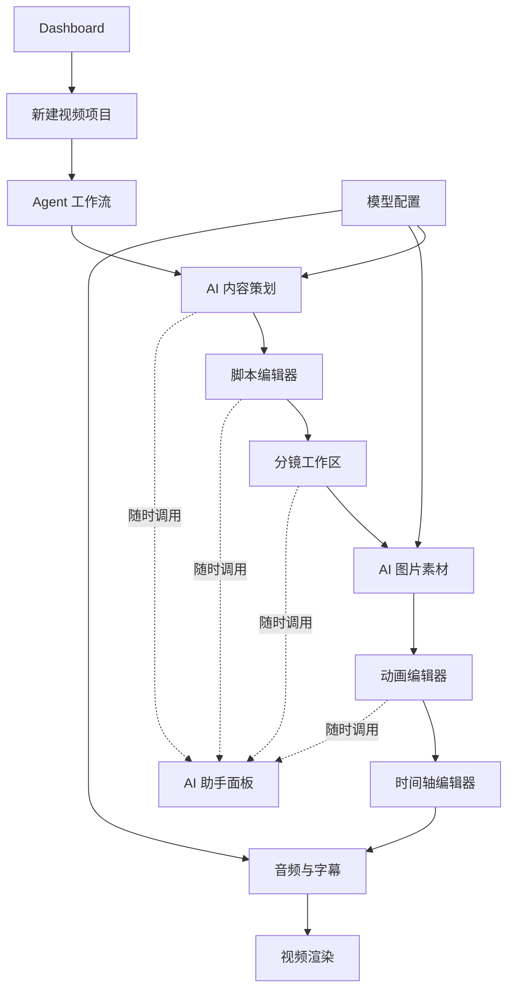
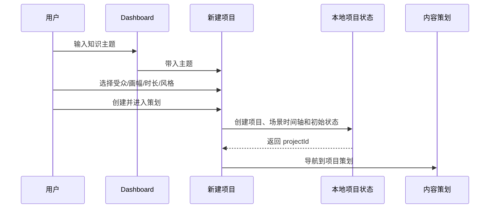

# KnowMotion AI Studio UI 设计规范

> 设计目标：AI 驱动的知识动画工作站，而不是聊天工具或传统 NLE。  
> 本阶段交付：设计规范、组件规范、页面布局、交互流程，以及可运行的前端交互原型。

## 1. 产品界面原则

1. **先表达创作结果**：界面优先展示主题、叙事结构、分镜和画面，不把对话框放在视觉中心。
2. **AI 是制作伙伴**：AI 以“建议、动作、状态”的形式嵌入各阶段，不抢占整个工作区。
3. **空间有明确职责**：左侧负责项目结构，中间负责当前创作对象，右侧负责属性或助手，底部负责时间与任务。
4. **深度优先于密度**：一次只展开当前任务必要的信息，高级参数折叠，避免传统剪辑软件的多面板压迫感。
5. **每个状态都可见**：已生成、待审核、素材缺失、渲染中、需要桌面服务，必须有明确标签。
6. **不伪造能力**：浏览器原型无法执行的密钥存储、模型请求和 Remotion 渲染，会标明限制并使用真实可执行的本地操作替代。

## 2. 视觉系统

### 2.1 色彩

| Token | 值 | 用途 |
|---|---|---|
| `--bg-canvas` | `#080b10` | 应用最底层背景 |
| `--bg-sidebar` | `#0b0f15` | 主导航 |
| `--bg-panel` | `#10161f` | 主面板 |
| `--bg-raised` | `#151d28` | 卡片、浮层、输入框 |
| `--border` | `#263140` | 常规边框 |
| `--text` | `#eef3f8` | 主文字 |
| `--text-muted` | `#8794a7` | 次要文字 |
| `--accent` | `#c8ff65` | AI 主操作、播放头、关键强调 |
| `--accent-soft` | `rgba(200,255,101,.12)` | 选中背景 |
| `--blue` | `#79a9ff` | 数据、链接、视频轨 |
| `--violet` | `#a78bfa` | 音频与生成任务 |
| `--amber` | `#ffbc66` | 待审核、风险提示 |
| `--danger` | `#ff6b7d` | 删除、失败 |

不使用大面积紫色渐变或霓虹装饰。渐变只用于创作预览和环境光。

### 2.2 字体与字号

- 界面字体：`Inter`, `Segoe UI`, `Microsoft YaHei UI`, sans-serif。
- 数字和状态：等宽数字特性 `font-variant-numeric: tabular-nums`。
- 字阶：10 / 11 / 12 / 13 / 14 / 16 / 20 / 28 / 40 px；正文与表单不得小于 12 px，状态胶囊不得小于 10 px。
- 正文行高 1.55；标题行高 1.15；段落最大宽度 72ch。
- 中文字重以 400/500/600 为主，主标题最多 700。

### 2.3 间距与尺寸

- 4 px 基础网格，常用间距 8 / 12 / 16 / 20 / 24 / 32 / 40。
- 全局侧栏 252 px；项目属性侧栏 250–320 px；工具栏 56–64 px。
- 卡片圆角 14 px；控件 9 px；对话框 20 px。
- 正常桌面目标宽度 1280–1920 px；1024 px 下收起辅助说明，不隐藏关键操作。

### 2.4 动效

- 控件切换：140–180 ms。
- 浮层进入：180–240 ms，使用 ease-out。
- 播放、生成、渲染进度使用真实动画，不添加无意义的持续背景动画。
- 遵守 `prefers-reduced-motion`，关闭缩放和位移动画。

## 3. 信息架构

主导航仅包含：Dashboard、新建项目、模型配置。项目进入后，工作流步骤成为第二层导航，不把所有页面平铺在微信式菜单里。

## 4. 页面布局规范

### 4.1 Dashboard

- 顶部：问候、全局助手按钮、创建入口。
- 中央 Hero：单行主题输入 + “开始策划”；下方提供可点击的主题起点。
- 下方：继续创作、最近项目、生产状态、能力状态。
- 无项目时 Hero 仍保持完整，并显示真实空状态，不填充虚构项目。
- 当前原型会提供一个明确标记为“示例”的可编辑项目，用于展示完整工作流。

### 4.2 新建视频项目

- 左 62%：模板、标题、主题、内容类型、受众、时长、比例、风格、语言。
- 右 38%：实时项目封面、画幅和节奏摘要。
- 底部：取消、创建并进入策划。
- 创建成功后写入本地持久状态并立即进入项目。

### 4.3 AI 内容策划

- 左：项目阶段轨道。
- 中：叙事策略选择、可编辑大纲段落、审批状态。
- 右：研究提示、来源记录、AI 建议。
- 操作：生成本地结构草案、添加/删除段落、审批大纲、进入脚本。
- “生成本地结构草案”是真实模板编排，不标记为模型生成。

### 4.2.1 Agent 工作流

- 顶部：当前运行、九 Agent DAG、自然语言增量修改入口。
- 中央：Agent 节点、依赖、模型、运行/审批/失败状态。
- 右侧：允许工具、Provider 路由、模型覆盖和最近输出。
- 底部：人工审批、可撤销项目修订、运行历史。
- 桌面模式调用真实 Provider；浏览器模式只展示定义和项目，不伪造 Agent 执行。

### 4.4 脚本编辑器

- 左：场景/段落列表，可新增、排序和删除。
- 中：旁白编辑区、视觉提示、镜头建议。
- 右：阅读时长、目标时长、状态、语音试听。
- 操作：从大纲生成脚本、系统语音试听、拆分场景、自动保存、进入分镜。

### 4.5 分镜工作区

- 顶：视图切换、生成分镜、添加场景。
- 中：卡片、列表或胶片条视图。
- 右：选中场景检查器。
- 操作：拖动排序、复制、删除、更新画面描述、跳转素材生成或动画预览。

### 4.6 AI 图片素材

- 左：选中场景、提示词、风格、比例和生成数量。
- 中：生成结果画廊与素材库。
- 右：选中素材详情、采用到场景、下载。
- 操作：本地生成 SVG 视觉草案、上传图片、采用素材、下载素材、重新生成。

### 4.7 动画编辑器

- 左：场景列表、图层列表。
- 中：播放器、安全框、场景预览、播放控制。
- 右：图层属性检查器。
- 底：精简时间轴。
- 操作：播放/暂停、拖动时间、选择图层、添加文字/形状、修改位置与透明度、复制/删除、下载当前场景快照。

### 4.8 时间轴编辑器

- 上：场景预览与播放头。
- 下：视频、旁白、字幕、音乐、音效多轨时间轴。
- 右：选中片段属性。
- 操作：拖动片段、调整起始时间与时长、添加片段、缩放时间轴、同步字幕、下载 SRT。

### 4.8.1 Remotion Studio

- 左：Composition 场景序列、风格与 Schema 状态。
- 中：Remotion Player 完整视频/单场景预览和独立播放控制。
- 右：镜头、转场、图层时间与 Schema 检查。
- 底：完整 MP4 渲染入口、DSL 导出、引擎能力覆盖和五场景示例。

### 4.9 AI 助手面板

- 位于应用右侧，可从任意项目页面打开，不覆盖主编辑对象太久。
- 顶部显示当前项目和“工作区动作”模式。
- 对话内容不是核心，核心是可执行动作卡片。
- 可执行动作直接修改当前项目：缩短场景、添加场景、切换竖屏、优化旁白、生成字幕。
- 不支持的自由文本会返回可执行建议，不伪装成模型回答。

### 4.10 音频与字幕

- 左：旁白段落、语音和语速。
- 中：旁白波形、字幕预审。
- 右：字幕样式与检查结果。
- 操作：系统语音试听、生成字幕、编辑字幕、导出 SRT、上传本地音频。

### 4.11 视频渲染

- 左：画幅、分辨率、帧率、预览编码和导出形式。
- 中：渲染预览、项目预检、进度、输出文件。
- 右：渲染日志和历史。
- 浏览器前端可以导出真实 WebM 预览、封面 PNG、项目 JSON；H.264/4K 正式渲染标明需要桌面渲染服务，不提供假成功按钮。

### 4.12 模型配置

- 顶部：密钥存储与桌面能力说明。
- 中部：Provider 卡片、能力标签、健康状态、默认模型绑定。
- 操作：添加/编辑/删除 Provider、启用切换、本地配置校验、保存任务模型映射。
- 浏览器原型不持久化 API Key；桌面版由系统凭据库保存。

## 5. 组件规范

### 5.1 基础组件

| 组件 | 行为规则 |
|---|---|
| `Button` | `primary`、`secondary`、`ghost`、`danger`；disabled 必须有原因或 tooltip |
| `IconButton` | 必须有 `aria-label` 和可见 focus |
| `Field` | label、hint、error 一体；错误不依赖颜色单独表达 |
| `SegmentedControl` | 单选，键盘方向键可用 |
| `Progress` | 同时显示百分比和阶段文本 |
| `Toast` | 成功/信息 3 秒、错误 6 秒；可关闭 |
| `Dialog` | 焦点陷阱、Escape 关闭、点击遮罩确认未保存内容 |
| `Pill` | 状态、能力、画幅；不使用超过 12 个字符的常驻胶囊 |
| `Inspector` | 只显示当前选中对象的可编辑属性 |

### 5.2 领域组件

| 组件 | 职责 |
|---|---|
| `ProjectRail` | 项目级工作流导航和生成状态 |
| `SceneCard` | 分镜预览、时长、旁白摘要、素材状态 |
| `StudioPlayer` | 浏览器内场景预览、播放、安全框 |
| `TimelineTrack` | 轨道、片段、缩放、拖拽和选择 |
| `AssistantDrawer` | 工作区动作对话和可应用建议 |
| `RenderChecklist` | 根据项目数据实时计算检查结果 |
| `ProviderCard` | Provider 能力、健康、默认任务映射 |
| `EmptyState` | 明确下一步和可执行入口 |

### 5.3 状态色语义

- 绿色：已完成、已配置、健康。
- 黄色：需要审核、待生成、需要注意。
- 蓝色：正在执行、可查看。
- 红色：失败、缺失、危险操作。
- 灰色：未开始、未配置、不可用。

## 6. 核心交互流程

### 6.1 新项目

### 6.2 从策划到脚本

1. 用户选择叙事策略。
2. 点击“生成本地结构草案”，按主题与受众生成五段结构。
3. 用户修改大纲段落。
4. 点击“审批大纲”，项目记录审核状态。
5. 点击“进入脚本”，系统根据大纲和每个段落的目标时长拆分场景。

### 6.3 分镜到动画

1. 从脚本生成分镜，每个场景获得画面描述、镜头类型和视觉提示。
2. 在分镜卡片中调整顺序和内容。
3. 进入素材生成，采用本地视觉草案或上传图片。
4. 在动画编辑器选择场景和图层，调整位置、大小、透明度。
5. 播放和拖动时间轴即时预览。

### 6.4 渲染

1. 运行真实项目预检：场景、旁白、素材、字幕。
2. 选择本地 720p/1080p WebM 预览。
3. Canvas 按项目内容制作动画并录制。
4. 完成后生成可播放、可下载的视频 Blob。
5. 4K/H.264 正式渲染保留桌面入口，并明确显示“桌面渲染服务未连接”。

## 7. 可访问性与键盘

- 所有交互元素支持 Tab 和 Enter/Space。
- 时间轴滑块和表单有可见 focus 环。
- 播放/暂停快捷键为 Space；避免在文本输入框中触发。
- Escape 关闭对话框或助手面板。
- 状态不只依赖颜色；图标和文字同时表达。
- 图标按钮使用中文或英文可读标签。

## 8. 当前实现的技术边界

- Tauri 2 负责桌面窗口、SQLite 和项目目录写入；同一份前端在浏览器中回退到 `localStorage`。
- 桌面模式下，项目状态写入 SQLite，并同步生成独立的 `project.json`、脚本、分镜、素材清单、动画时间轴和字幕文件。
- Tailwind CSS v4 负责工具类和设计 Token。全局 `styles.css` 只保留重置、Token、公共动画与可访问性规则；按钮、字段等基础控件以及每个页面/领域组件的专属样式分别位于同名 CSS 文件，并在组件入口中导入。
- 图片生成是真实可执行的本地 SVG 视觉草案生成器，不伪装为在线 AI 图片。
- 旁白试听使用系统 Web Speech API。
- 视频预览使用 Canvas + MediaRecorder 生成 WebM。
- API Key 不持久化，桌面端接入后才由 Rust 和系统凭据库保存。
- Remotion Player、Provider 网络调用、Tauri sidecar 和正式 MP4 渲染需要后续桌面集成。
